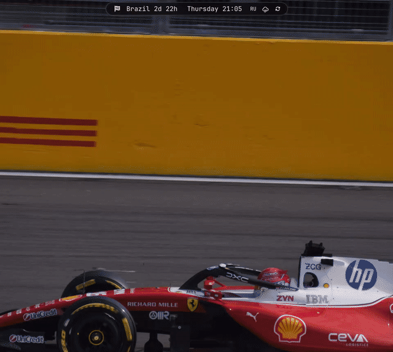

# Ferrari Omarchy

My setup on top of [Omarchy](https://omarchy.org/) (Arch + Hyprland): a Ferrari theme, blurred glass, rounded windows, a bar made of three "islands", and F1 widgets.


| Glass and rounded corners | F1 in the bar | Music in the bar |
|---|---|---|
|  |  |  |

Bar panels open like a liquid drop: it gathers under the icon, drips off the bar, and spreads into a card.



## What's inside

| What | Files |
|---|---|
| **Ferrari theme**: red accent `#c8102e`, dark maroon background, Charles Leclerc wallpapers, a VS Code theme, Yaru-red icons | `config/omarchy/themes/ferrari/` |
| **Glass**: native Hyprland blur behind windows, the bar, menus, and notifications; translucent foot | `config/hypr/looknfeel.lua`, `config/omarchy/shell.toml`, `config/foot/foot.ini` |
| **Rounded corners** (16px) and tight gaps (3/5) | `config/hypr/looknfeel.lua` |
| **Animations**: soft ease-out curves, popin with overshoot, workspace slide | `config/hypr/looknfeel.lua` |
| **Three-island bar**: left, center, and right "pills" | `config/omarchy/plugins/fedor.bar` |
| **Drop-style bar panels**: a drop gathers under the icon on a "bridge" from the bar, stretches, spreads into a card, and springs into place; on close it gets pulled back in. Works for every dropdown panel (Wi-Fi, Bluetooth, audio, weather, F1, music) without touching `/usr/share` | `config/omarchy/plugins/fedor.bar/PeelFx.qml` |
| **Stutter-free Wi-Fi**: the stock panel rebuilt the network list for each of the ~25 networks found during a scan, freezing the shell for ~200 ms. The clone batches updates and starts the scan after the animation | `config/omarchy/plugins/fedor.network` |
| **Tray** that expands on hover | `config/omarchy/plugins/fedor.tray` |
| **Indicators** with animated appearance | `config/omarchy/plugins/fedor.indicators` |
| **F1 in the bar**: race countdown, schedule, driver standings, latest result ([Jolpica](https://github.com/jolpica/jolpica-f1)) | `config/omarchy/plugins/fedor.f1` |
| **F1 on the desktop**: next Grand Prix card with the track map and weather forecast ([OpenF1](https://openf1.org), [MultiViewer](https://multiviewer.app), [Open-Meteo](https://open-meteo.com)) | `config/omarchy/plugins/fedor.f1-next` |
| **Music in the bar**: the current track to the right of the clock with a red progress line; clicking it opens a panel with cover art, seeking, and controls. Works with any MPRIS player | `config/omarchy/plugins/fedor.music` |
| **macOS-style window screenshots**: `Super+Shift+S` works as usual, but clicking a window gives it transparent rounded corners (cut just inside Hyprland's rounding, so no border fringe is left), a thin hairline and a soft shadow on an even margin; a dragged region is saved as is. `Super+Ctrl+Shift+S` picks windows only, `Shift+Print` takes the focused one. `MAC_SHOT_SHADOW=0` drops the shadow, `MAC_SHOT_OUTLINE=none` the hairline | `bin/screenshot-window-mac` |
| **Bindings and layout**: `Super+Shift+S` screenshot, `Super+Shift+R` screen recording, `Super+V` float/tile, us/ru on `Alt+Shift` | `config/hypr/bindings.lua`, `config/hypr/input.lua` |

## Installation

Requires an existing Omarchy install.

```bash
git clone https://github.com/fedorrodicev-lgtm/omarchy-setup ~/omarchy-setup
~/omarchy-setup/install.sh
```

`install.sh` copies `config/` into `~/.config` and `bin/` into `~/.local/bin`, saves any replaced files to `~/.config/dotfiles-backup-<timestamp>/`, and applies the theme.

`bindings.lua` and `input.lua` are tailored to me (Telegram, VS Code, Happ, Russian keyboard layout). If you don't want them, remove them from `config/hypr/` before installing.

## Updating the repo

```bash
./sync.sh          # copies live configs from ~/.config using a whitelist
git diff           # check what's going in
git commit -am "..."
```

## ASUS TUF F17 FX707VV

The suspend wake-up fix for this laptop lives in a separate repo: [asus-tuf-fx707vv-suspend-fix](https://github.com/fedorrodicev-lgtm/asus-tuf-fx707vv-suspend-fix).

## Credits

- `fedor.bar`, `fedor.tray`, `fedor.indicators`, and `fedor.network` are clones of the `omarchy.bar`, `omarchy.tray`, `omarchy.indicators`, and `omarchy.network` plugins from [Omarchy](https://github.com/basecamp/omarchy), with my changes.
- Photos are from Wikimedia Commons under CC BY-SA 4.0 / CC BY 4.0 / public domain. Authors and links are listed in [`CREDITS.txt`](config/omarchy/themes/ferrari/backgrounds/CREDITS.txt). Wallpapers 11–14 from that file are not included in the repo because they aren't freely licensed.
