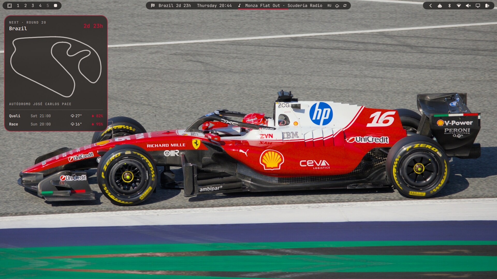
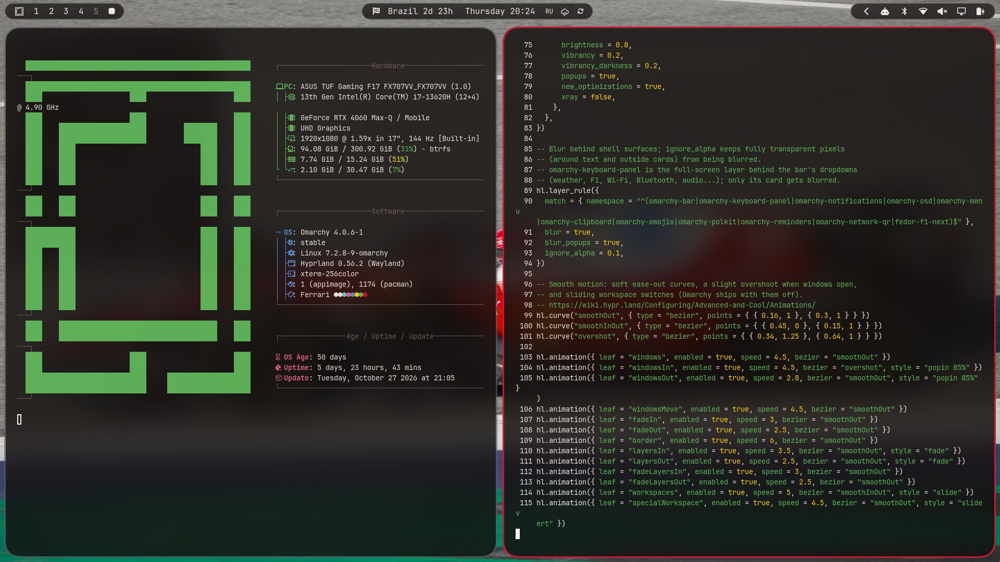
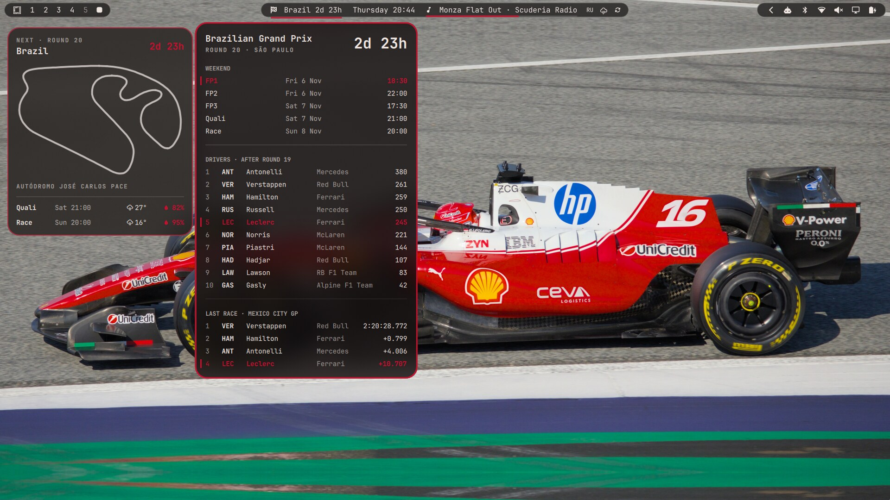
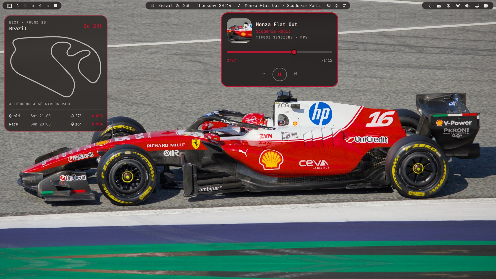

# Ferrari Omarchy

Мой сетап поверх [Omarchy](https://omarchy.org/) (Arch + Hyprland): тема Ferrari, стекло с размытием, скруглённые окна, бар из трёх «островков» и F1-виджеты.



| Стекло и скругления | F1 в баре | Музыка в баре |
|---|---|---|
|  |  |  |

## Что внутри

| Что | Файлы |
|---|---|
| **Тема Ferrari**: красный акцент `#c8102e`, тёмно-бордовый фон, обои с Шарлем Леклером, тема для VS Code, иконки Yaru-red | `config/omarchy/themes/ferrari/` |
| **Стекло**: нативный blur Hyprland за окнами, баром, меню и уведомлениями; полупрозрачный foot | `config/hypr/looknfeel.lua`, `config/omarchy/shell.toml`, `config/foot/foot.ini` |
| **Скругления** 16px и узкие отступы (3/5) | `config/hypr/looknfeel.lua` |
| **Анимации**: мягкие ease-out кривые, popin с overshoot, слайд воркспейсов | `config/hypr/looknfeel.lua` |
| **Бар с тремя островками**: левый, центральный и правый «пилюли» | `config/omarchy/plugins/fedor.bar` |
| **Трей**, раскрывающийся по наведению | `config/omarchy/plugins/fedor.tray` |
| **Индикаторы** с анимированным появлением | `config/omarchy/plugins/fedor.indicators` |
| **F1 в баре**: отсчёт до гонки, расписание, личный зачёт, последний результат ([Jolpica](https://github.com/jolpica/jolpica-f1)) | `config/omarchy/plugins/fedor.f1` |
| **F1 на рабочем столе**: карточка следующего Гран-при со схемой трассы и прогнозом погоды ([OpenF1](https://openf1.org), [MultiViewer](https://multiviewer.app), [Open-Meteo](https://open-meteo.com)) | `config/omarchy/plugins/fedor.f1-next` |
| **Музыка в баре**: текущий трек справа от часов с красной полоской прогресса; по клику открывается панель с обложкой, перемоткой и кнопками. Работает с любым MPRIS-плеером | `config/omarchy/plugins/fedor.music` |
| **Бинды и раскладка**: `Super+Shift+S` скриншот, `Super+Shift+R` запись экрана, `Super+V` float/tile, us/ru по `Alt+Shift` | `config/hypr/bindings.lua`, `config/hypr/input.lua` |

## Установка

Нужен установленный Omarchy.

```bash
git clone https://github.com/fedorrodicev-lgtm/omarchy-setup ~/omarchy-setup
~/omarchy-setup/install.sh
```

`install.sh` копирует `config/` в `~/.config`, сохраняет заменённые файлы в `~/.config/dotfiles-backup-<время>/` и применяет тему.

`bindings.lua` и `input.lua` заточены под меня (Telegram, VS Code, Happ, русская раскладка). Если не нужны, удали их из `config/hypr/` до установки.

## Обновление репо

```bash
./sync.sh          # копирует живые конфиги из ~/.config по белому списку
git diff           # проверить, что уходит
git commit -am "..."
```

## ASUS TUF F17 FX707VV

Фикс пробуждения из сна для этого ноутбука лежит отдельно: [asus-tuf-fx707vv-suspend-fix](https://github.com/fedorrodicev-lgtm/asus-tuf-fx707vv-suspend-fix).

## Авторство

- `fedor.bar`, `fedor.tray` и `fedor.indicators` — клоны плагинов `omarchy.bar`, `omarchy.tray` и `omarchy.indicators` из [Omarchy](https://github.com/basecamp/omarchy) с моими правками.
- Фото взяты с Wikimedia Commons под CC BY-SA 4.0 / CC BY 4.0 / public domain. Авторы и ссылки перечислены в [`CREDITS.txt`](config/omarchy/themes/ferrari/backgrounds/CREDITS.txt). Обои 11–14 из того же файла в репо не входят, потому что у них нет свободной лицензии.
